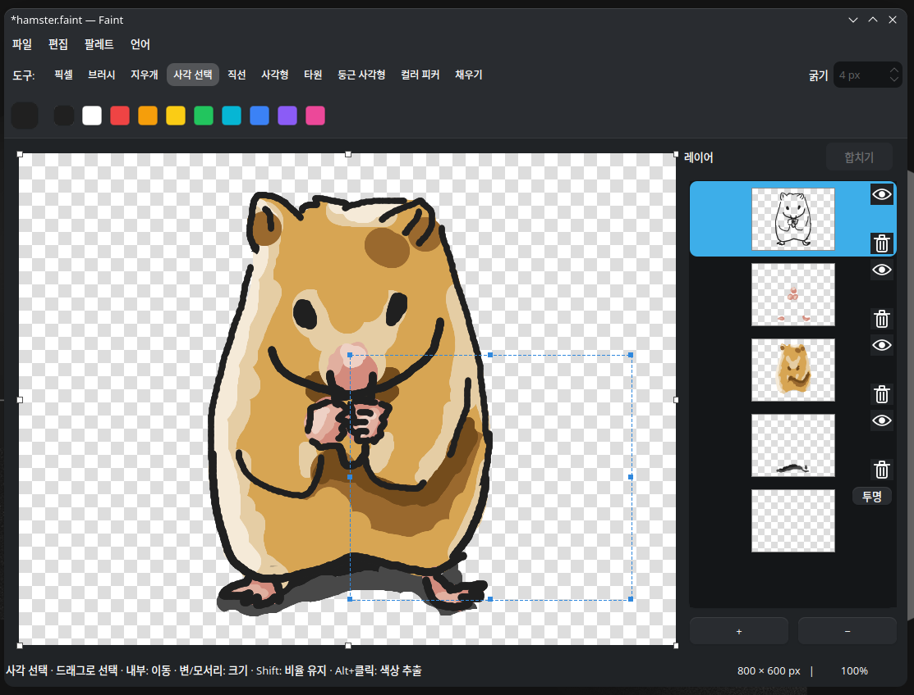

# Faint

[English](README.md) · **한국어**

레이어, 투명도, 픽셀 그리기를 지원하는 가벼운 리눅스 그림판입니다.

[주요 기능](#주요-기능) · [시작하기](#시작하기) · [단축키](#단축키) · [빌드](#빌드)



## 주요 기능

- **그리기 도구** — 브러시, 지우개, 픽셀, 직선, 사각형, 타원, 둥근 사각형, 컬러 피커, 채우기를 제공합니다.
- **레이어** — 미리보기, 표시·숨기기, 드래그로 순서 변경, 선택한 여러 레이어 합치기를 지원합니다.
- **투명도** — 알파 색상, 투명 영역 체크무늬, 투명 또는 흰색 배경을 지원합니다.
- **선택 편집** — 선택 영역 이동·크기 조절, Shift로 비율 유지, 현재 레이어 또는 보이는 이미지 복사가 가능합니다.
- **자유로운 캔버스** — 변이나 모서리를 드래그해 크기를 바꾸고, 정확한 크기 입력·화면 이동·확대 및 축소를 할 수 있습니다.
- **간편한 불러오기** — 이미지를 붙여넣거나 PNG/JPEG/WebP/BMP/GIF 파일을 드롭하면 새 레이어로 추가하고 캔버스를 필요한 만큼 확장합니다.
- **팔레트** — 자주 쓰는 색상을 모아 저장하고 다시 불러올 수 있습니다.

## 시작하기

Python 3.10 이상이 필요합니다.

```bash
python3 -m venv .venv
source .venv/bin/activate
pip install -e .
python -m faint
```

KDE에서 시스템 Python에 PySide6가 설치되어 있다면 `./run.sh`로 데스크톱 테마를 적용해 실행할 수 있습니다.

KDE Plasma/Bazzite에서 실행을 확인했습니다. 다른 리눅스 데스크톱에서는 모양이 다를 수 있습니다. **언어 → English / 한국어**에서 즉시 전환할 수 있으며 선택은 다음 실행에도 유지됩니다. 처음에는 운영체제 언어를 따르고, 지원하지 않는 언어는 영어로 표시합니다.

## 이미지 작업

| 형식 | 보존하는 내용 |
| --- | --- |
| `.faint` | 편집 가능한 레이어, 투명도, 표시 상태, 배경 설정 |
| `.png` | 투명도를 포함한 화면에 보이는 이미지 |
| `.jpg` / `.jpeg`, `.bmp` | 흰색 배경에 합친 화면에 보이는 이미지 |
| `.webp` | 투명도를 포함한 화면에 보이는 이미지 |
| `.gif` | 최대 256색과 투명/불투명을 지원하는 정지 이미지 |

나중에 레이어를 이어서 편집하려면 **`.faint`**로 저장하세요. PNG나 JPEG를 열면 단일 이미지 레이어가 됩니다.

선택 영역 안쪽을 드래그하면 이동하고, 변이나 모서리를 드래그하면 크기를 조절합니다. 바깥을 클릭하면 선택이 해제됩니다. 선택 영역이나 캔버스 크기를 조절할 때 **Shift**를 누르면 비율을 유지합니다.

**Shift+클릭**으로 여러 레이어를 선택한 다음 레이어 창의 **합치기**를 누르세요. 각 레이어에는 표시·숨기기와 삭제 버튼도 있습니다.

## 단축키

| 도구 | 키 |
| --- | --- |
| 픽셀 | `P` |
| 브러시 | `B` |
| 지우개 | `E` |
| 사각 선택 | `S` |
| 직선 | `L` |
| 사각형 | `R` |
| 타원 | `C` |
| 둥근 사각형 | `Ctrl+R` |
| 채우기 | `F` |

<details>
<summary>편집과 화면 조작</summary>

| 동작 | 단축키 |
| --- | --- |
| 불러오기 / 저장 / 다른 이름으로 저장 | `Ctrl+O` / `Ctrl+S` / `Ctrl+Shift+S` |
| 실행 취소 / 다시 실행 | `Ctrl+Z` / `Ctrl+Y` 또는 `Ctrl+Shift+Z` |
| 현재 레이어의 선택 영역 복사 | `Ctrl+C` |
| 선택 영역 안의 보이는 이미지 복사 | `Ctrl+Shift+C` |
| 잘라내기 / 새 레이어로 붙여넣기 | `Ctrl+X` / `Ctrl+V` |
| 전체 선택 / 선택 해제 / 선택한 픽셀 삭제 | `Ctrl+A` / `Esc` / `Delete` |
| 캔버스 크기 입력 | `Ctrl+E` |
| 일시적으로 색상 추출 | `Alt+클릭` |
| 화면 이동 | 마우스 가운데 버튼 드래그 |
| 도구 굵기 변경 | 마우스 휠 |
| 확대·축소 | `Ctrl+휠` 또는 상태바의 배율 클릭 |

브러시로 그릴 때 **Shift**를 누르면 수평·수직으로 제한됩니다. Shift를 누른 채 선택을 시작하면 정사각형으로 지정하고, 도형을 그릴 때 누르면 가로와 세로 길이를 같게 만듭니다.

</details>

## 빌드

시스템 PySide6와 C 컴파일러가 설치된 KDE 환경에서 실행하세요.

```bash
./build.sh           # 폴더 형태로 빌드
./build.sh onefile   # 단일 실행 파일로 빌드
```

폴더 빌드는 `./dist/run_faint.dist/faint`, 단일 파일 빌드는 `./dist/faint`로 실행합니다. 폴더 빌드를 배포할 때는 `run_faint.dist` 폴더 전체를 전달하세요.

일반 리눅스 빌드는 `FAINT_KDE=0 ./build.sh`를 사용합니다. 빌드 과정에서 의존성을 다운로드하며, 배포할 환경에서도 실행을 확인해야 합니다.

## KDE 클립보드 기록

다른 앱에 이미지가 붙여넣어지지만 **Super+V** 목록에 없다면 KDE 클립보드 설정에서 **명시적으로 복사한 이미지 데이터(Image data copied explicitly)**를 켜세요. 이전 버전에서는 **이미지 무시(Ignore images)**를 해제합니다.

## 설치

```bash
./install.sh
```

단일 실행 파일을 빌드해 `~/.local/bin/faint`에 설치하고, 현재 사용자의 앱 검색과 PNG·JPEG·WebP·BMP·GIF **다른 앱으로 열기** 목록에 **Faint**를 등록합니다. 관리자 권한이 필요하지 않으며 기존 이미지 기본 앱은 유지되며 `.faint`는 Faint로 연결됩니다. 업데이트할 때도 같은 명령을 실행하세요. 설치된 앱은 소스 폴더와 독립적으로 실행됩니다.

실행 파일 설치 위치를 바꾸려면 `FAINT_INSTALL_DIR=/원하는/경로 ./install.sh`를 사용하세요. 앱 등록 위치는 `XDG_DATA_HOME` 설정을 따릅니다.

## 삭제

```bash
./uninstall.sh
```

설치한 실행 파일과 앱 등록을 삭제하고 앱 목록을 갱신합니다. 저장한 그림, 소스 코드, 환경설정은 유지됩니다. 설치 경로를 지정했다면 같은 값으로 실행하세요: `FAINT_INSTALL_DIR=/원하는/경로 ./uninstall.sh`. `XDG_DATA_HOME`도 설치할 때와 같은 설정을 사용하세요.

## 파일 관리자에서 열기

`./install.sh`를 실행하면 PNG·JPEG·WebP·BMP·GIF **다른 앱으로 열기** 목록에도 Faint가 자동 등록됩니다. Dolphin에서 이미지를 우클릭하고 **다른 앱으로 열기 → Faint**를 선택하세요. 별도 등록 명령은 필요하지 않습니다. `./uninstall.sh`는 이 등록도 해제하고 앱 목록을 갱신합니다. 기존 이미지 기본 앱은 변경하지 않습니다.

`.faint`는 전용 프로젝트 형식으로 등록되어 기본적으로 Faint로 열립니다. 삭제 시 파일 형식 등록과 Faint 연결도 해제합니다. WebP·JPEG·BMP·GIF의 불러오기·저장·레이어 드롭을 지원합니다. GIF는 첫 프레임을 불러오며 최대 256색·투명/불투명의 정지 이미지로 저장합니다. JPEG·BMP는 흰 배경으로 저장합니다.
