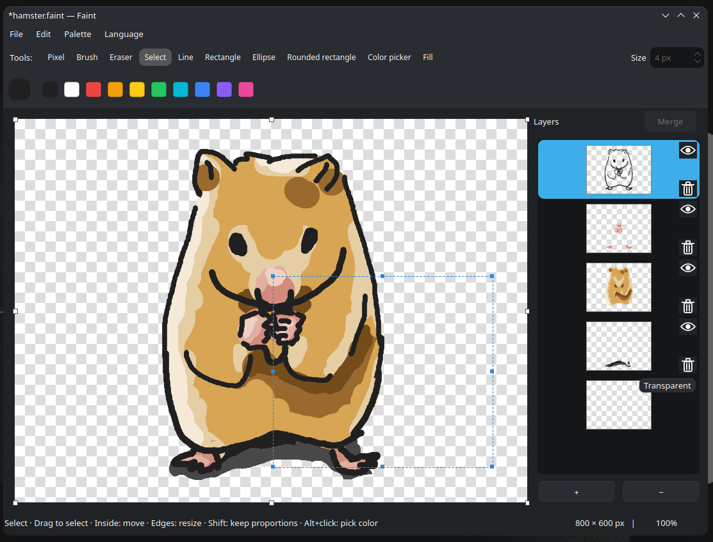

<p align="center">
  
</p>

# Faint

**English** · [한국어](README.ko.md)

A lightweight paint app for Linux, with layers, transparency, and pixel drawing.

[Features](#features) · [Getting started](#getting-started) · [Shortcuts](#shortcuts) · [Build](#build)



## Features

- **Drawing tools** — brush, eraser, pixel pencil, lines, rectangles, ellipses, rounded rectangles, color picker, and fill.
- **Layers** — thumbnail previews, visibility toggles, drag-to-reorder, and merging multiple selected layers.
- **Transparency** — alpha colors, a checkerboard preview, and a transparent or white background.
- **Selection editing** — move and resize a selection, keep its proportions with Shift, and copy from one layer or the visible image.
- **Flexible canvas** — drag an edge or corner to resize, enter exact dimensions, pan, and zoom.
- **Easy imports** — paste images or drop PNG/JPEG/WebP/BMP/GIF files to add new layers. The canvas grows to fit.
- **Reusable palettes** — collect colors and save or load your palettes.

## Getting started

Requires Python 3.10 or later.

```bash
python3 -m venv .venv
source .venv/bin/activate
pip install -e .
python -m faint
```

On KDE, if PySide6 is already installed for your system Python, use `./run.sh` to launch with your desktop's theme.

The app has been tested on KDE Plasma/Bazzite. Other Linux desktops may have a different appearance. English and Korean are supported. Choose **Language → English / 한국어** to switch instantly; your choice is remembered. The system language is used on first launch, with English as the fallback.

## Working with images

| Format | What it keeps |
| --- | --- |
| `.faint` | Editable layers, transparency, visibility, and background settings. |
| `.png` | The visible image, including transparency. |
| `.jpg` / `.jpeg`, `.bmp` | The visible image on a white background. |
| `.webp` | The visible image, including transparency. |
| `.gif` | A single frame, up to 256 colors and binary transparency. |

Save as **`.faint`** to continue editing layers later. Opening a raster image creates a single image layer. WebP, BMP, GIF and JPEG (`.jpg` / `.jpeg`) are also supported for opening, saving and dropping into layers. GIF opens the first frame and saves a still image with up to 256 colors and binary transparency. JPEG and BMP use a white background.

Drag inside a selection to move it, or drag its edges and corners to resize it. Click outside the selection to deselect. Hold **Shift** to keep proportions while resizing selections or the canvas.

Use **Shift+click** to select multiple layers, then choose **Merge** in the layer panel. Each layer also has visibility and delete controls.

## Shortcuts

| Tool | Key |
| --- | --- |
| Pixel pencil | `P` |
| Brush | `B` |
| Eraser | `E` |
| Rectangular selection | `S` |
| Line | `L` |
| Rectangle | `R` |
| Ellipse | `C` |
| Rounded rectangle | `Ctrl+R` |
| Fill | `F` |

<details>
<summary>Editing and navigation</summary>

| Action | Shortcut |
| --- | --- |
| Open / Save / Save as | `Ctrl+O` / `Ctrl+S` / `Ctrl+Shift+S` |
| Undo / Redo | `Ctrl+Z` / `Ctrl+Y` or `Ctrl+Shift+Z` |
| Copy selected pixels from the current layer | `Ctrl+C` |
| Copy the visible image within the selection | `Ctrl+Shift+C` |
| Cut / Paste into a new layer | `Ctrl+X` / `Ctrl+V` |
| Select all / Deselect / Delete selected pixels | `Ctrl+A` / `Esc` / `Delete` |
| Set canvas dimensions | `Ctrl+E` |
| Pick a color temporarily | `Alt+click` |
| Pan | Middle-button drag |
| Change tool size | Mouse wheel |
| Zoom | `Ctrl+wheel`, or click the percentage in the status bar |

Hold **Shift** while drawing with the brush to constrain strokes horizontally or vertically. Start a selection with Shift for a square, or hold Shift while drawing a shape for equal width and height.

</details>

## Build

On a KDE system with system PySide6 and a C compiler installed:

```bash
./build.sh           # Folder build
./build.sh onefile   # Single executable
```

Run the folder build with `./dist/run_faint.dist/faint`, or the single-file build with `./dist/faint`. When sharing a folder build, include the entire `run_faint.dist` folder.

For a general Linux build, use `FAINT_KDE=0 ./build.sh`. Builds download dependencies and should be tested on the target system.

## KDE clipboard history

If an image pastes into other apps but does not appear in **Super+V**, enable **Image data copied explicitly** in KDE's clipboard history settings. On older versions, turn off **Ignore images**.

## Install

```bash
./install.sh
```

This builds a single executable, installs it to `~/.local/bin/faint`, and registers **Faint** in app search and the PNG/JPEG/WebP/BMP/GIF **Open With** list for your user. No administrator privileges are needed; existing image default apps stay unchanged. `.faint` projects are registered to open with Faint. Run the same command again to update. The installed app works independently of the source folder.

To choose a different executable directory, use `FAINT_INSTALL_DIR=/your/path ./install.sh`. Application registration follows `XDG_DATA_HOME` when set.

## Uninstall

```bash
./uninstall.sh
```

Removes the installed executable and app registration, then refreshes the app list. Saved images, source files and preferences are preserved. If you installed to a custom directory, use the same `FAINT_INSTALL_DIR` value: `FAINT_INSTALL_DIR=/your/path ./uninstall.sh`. Use the same `XDG_DATA_HOME` setting as during installation.

## Open from a file manager

`./install.sh` automatically registers Faint in the PNG/JPEG/WebP/BMP/GIF **Open With** list. In Dolphin, right-click an image and choose **Open With → Faint**. No separate registration command is needed. `./uninstall.sh` removes this registration and refreshes the app list. Existing image default apps are not changed. The `.faint` extension is registered as a Faint project and opens with Faint by default; uninstall removes its type registration and Faint association.
